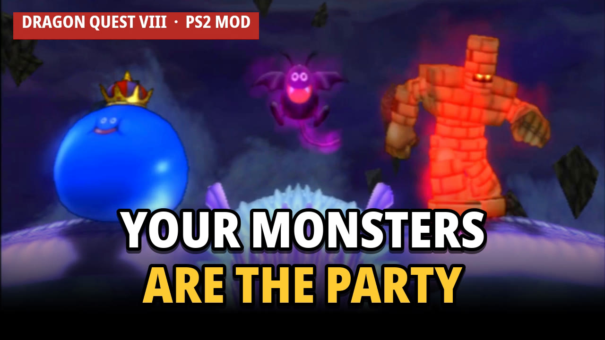

# Dragon Quest VIII: Journey of the Cursed Monsters

*A monster-team mod for Dragon Quest VIII (PS2)*

Play Dragon Quest VIII (PS2) with your **monster team as the main party**. Your monsters fight every battle from the
start, you can command them yourself and Team 1's first monster walks around the
world in place of the hero.

Free mod. It contains only the mod's own code: you need your own copy of the game.

**Trailer:** https://youtu.be/aSksGuMsIC8

## Download

Get `DQ8_CursedMonsters_v1.0.zip` from the [Releases page](https://github.com/PauloAxcel/dq8-cursed-monsters/releases).

## Essential Features

- **The team fights every battle.** Team 1 joins at the start of every battle and stays until the battle ends
  (except in the Arena and a few story fights).
- **Start with a team.** A new game begins with Morrie's starters (Smiles, Squiggles, Lonely Joe). The Team menu is available from the start, and every named monster appears in the wild from the start.
- **Extended monster bank** instead of 12.
- **Command your monsters.** With the team out, you can control your monster team as if it's your usual party.
- **Your monster on the field:** Team 1's first monster walks in place of the hero (cosmetic: events still use the
  hero).
- **World map:** When you open the World map you might get surprised.

## What you need

One of these, as an ISO image of your own disc:

| Version | Serial | ISO size | SHA-1 of the ISO the patch expects |
|---|---|---|---|
| Europe/Australia (PAL) | SLES-53974 | 4,067,000,320 bytes | `1c060a9cd4a0fa75114c6a6d5769974046ba3497` |
| USA (NTSC-U) | SLUS-21207 | 4,180,148,224 bytes | `a8410e3f5cbca3aaf7445c3babfce29621e37b2d` |

The Japanese version is not supported.

## Install: patch your ISO (any emulator, real PS2 untested)

Keep a copy of your original ISO. Use the patch for your version from the `patches/` folder:

- **Windows:** [Delta Patcher](https://github.com/marco-calautti/DeltaPatcher): original file = your ISO, patch =
  `DQ8_CursedMonsters_PAL.xdelta` (or `_US`), then apply.
- **Linux / macOS:** `xdelta3 -d -s "your original.iso" DQ8_CursedMonsters_PAL.xdelta DQ8_CursedMonsters_PAL.iso`

If the patcher reports a checksum error, your ISO is not the one listed above (different dump or version).
Then boot the patched ISO as usual (PCSX2 or any PS2 emulator). It has every feature built in.

## Saves

- Memory-card saves work: old saves are converted the first time the team code runs (your monsters move to the new,
  bigger bank).
- Once you have saved with the mod, playing that save **without** the mod hides the monsters that moved to the new
  bank (they come back when the mod is on again). Keep a backup of your memory card if you might go back.
- Emulator save states are tied to the exact ISO: states from the original ISO don't load on the patched one.

## Known issues

- While riding the Sabrecat, sailing or flying with the Godbird, the hero is shown instead of your monster.
- Some "monsters" on your team may stand in a T-pose in battle (e.g. Empyrea).
- The flee scene can look odd (monsters play their run motion).
- In the Manual move list some moves show the game's internal names (e.g. "SORROW ATTACK 1"), and a few special moves
  are not listed (on Auto they work).
- Fights the story wants the humans for (the Sea Dragon and the Sun Mirror, Rhapthorne's shield): choose **Away** in
  the battle menu so the humans fight.
- Untested on real PS2 hardware and loaders such as OPL.

## Future work

If there is interest:
- more monsters to recruit, and possibly more attacks for them;
- smoothing out the known issues above.

Next project: a mod for **Final Fantasy X**.

## Version history

See [CHANGELOG.md](CHANGELOG.md).

## Feedback and bugs

Open an [issue](https://github.com/PauloAxcel/dq8-cursed-monsters/issues) (the bug form asks for the game version,
the emulator and what happened; a save state helps a lot).

## Credits

Made by [PauloAxcel](https://github.com/PauloAxcel) with Claude Opus 5.5. Reverse engineering and patches built with
Ghidra, PCSX2's debugger and a lot of save states.
Dragon Quest is © Square Enix / Armor Project / Bird Studio / Level-5. This is a free, unofficial fan mod; it
contains no game data.

Licence: [CC BY-NC 4.0](LICENSE): share and adapt with credit, no commercial use.

If you enjoy it, you can support the project on Ko-fi: https://ko-fi.com/pauloaxcel (optional, the mod stays free).
